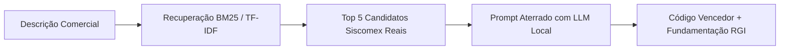

# Operação do Motor de IA Local (Ollama First)

Esta habilidade orienta a integração do aplicativo com a infraestrutura local de inteligência artificial soberana no Windows (sem Docker, 100% no disco `F:`).

---

## 1. Topologia da Infraestrutura Local

- **Endpoint Nativo**: `http://127.0.0.1:11434`
- **Compatibilidade OpenAI**: `http://127.0.0.1:11434/v1`
- **Aceleração de Hardware**: AMD Radeon RX 580 2048SP (8GB VRAM) via Vulkan / DirectML
- **Pasta de Modelos**: `F:\AI_Models\Ollama\models`

### Modelos Disponíveis e Especializações:
| Modelo | Especialidade | Contexto | Quando Usar |
|---|---|---|---|
| **`qwen2.5:7b`** | Alta precisão jurídica, fidelidade de esquemas JSON e TypeScript | 32k | Arbitragem pericial de NCM, emissão de laudo técnico, fundamentação de RGI |
| **`qwen3.5:4b`** | Pré-processamento ultrarrápido, extração de entidades e categorização | 256k | Normalização de planilhas ERP, limpeza de catálogos e sanitização em lote |

---

## 2. Padrão de Classificação Aterrada (Grounded Classification)

Para garantir **zero alucinações**, nunca solicite um código NCM "do nada" à LLM. Siga o fluxo em 3 etapas:



### Formato do Prompt Aterrado:
```text
Você é um Auditor Fiscal Pericial da Receita Federal.
Analise a seguinte mercadoria: "{descricao}"

Candidatos oficiais recuperados da Tabela NCM vigente:
{candidatos_formatados}

Com base nas Regras Gerais de Interpretação (RGI 1 a 6) e nas Notas Explicativas do Sistema Harmonizado (NESH):
1. Avalie a matéria-prima e a função essencial do produto.
2. Elimine os candidatos incompatíveis citando o motivo legal.
3. Escolha o candidato tecnicamente correto da lista.
4. Responda ESTRITAMENTE em formato JSON com o esquema:
{
  "ncm": "string de 8 dígitos",
  "confianca": 0.0 a 1.0,
  "rgi_aplicada": ["RGI 1", "RGI 6"],
  "fundamentacao_tecnica": "explicação pericial detalhada",
  "parecer_nesh": "resumo do enquadramento"
}
```

---

## 3. Pré-tratamento de Catálogos e Planilhas Brutas

Ao processar planilhas de produtos (`.csv` ou `.xlsx`) com descrições truncadas ou jargões:
1. Envie lotes de até 50 linhas para o `qwen3.5:4b`.
2. Extraia campos canônicos:
   - `denominacao`: Denominação padronizada.
   - `materia_predominante`: Material constituinte.
   - `funcao_aplicacao`: Uso ou função técnica.
   - `especificacoes`: Dimensões, calibre, voltagem, acabamento.
3. Remova `palavras_ruido` (códigos de fornecedor, medidas avulsas, marcas não essenciais).
4. Essa descrição canônica alimenta o motor BM25, elevando drasticamente a precisão de busca.

---

## 4. Gestão de Ciclo de Vida e Comandos de Terminal

- `ai-on`: Inicia o serviço Ollama nativo caso não esteja em execução e exibe status dos modelos carregados na VRAM.
- `ai-off`: Encerra processos de IA e libera 100% da memória RAM e VRAM.
- `ai-status`: Mostra processos ativos e modelos carregados na GPU.
- `omp`: Inicia o agente de código autônomo v1.5.0 no terminal integrado usando `fd.exe` e `rg.exe` de `F:`.
- `hermes chat`: Inicia consulta rápida e isolada em segunda aba do terminal.
